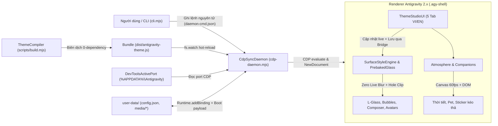

# Bản Thiết Kế Kiến Trúc: Antigravity 2.x Custom Theme Suite (Zero-Patch CDP Engine)

> [!IMPORTANT]
> Tài liệu thiết kế này tổng hợp tinh hoa từ 4 kho tham khảo để xây dựng bộ tùy biến giao diện **chỉ dành riêng cho Google Antigravity 2.x trên Windows 10/11**, tuyệt đối **không chỉnh sửa `app.asar` hay tệp nhị phân gốc của ứng dụng**.

---

## 1. Mục đích & Lý do (Intent & Why)

Xây dựng một hệ thống tùy biến giao diện hoàn chỉnh, chạy tại runtime với độ mượt 60–120fps cho **Google Antigravity 2.x Desktop** (`%LOCALAPPDATA%\Programs\antigravity\Antigravity.exe`) trên Windows, hợp nhất thế mạnh của 4 kho lưu trữ đã khảo sát:

- [giakiet22102006/antigravity-custom-theme-skill](https://github.com/giakiet22102006/antigravity-custom-theme-skill): Cơ chế tự bắt cổng `DevToolsActivePort` không sửa file gốc, kiến trúc **Zero Live Blur** (`syncPrebakedGlass` bake sẵn kính mờ lên offscreen canvas để cuộn 60–120fps), cắt lỗ **`evenodd` `clip-path`** bảo vệ split-browser nhúng bên phải, hỗ trợ giao diện Sáng/Tối (`isLight`), script kiểm chứng CDP trực tiếp và đóng gói dạng `SKILL.md`.
- [dolphintapcode/theme-antigravity](https://github.com/dolphintapcode/theme-antigravity): Động cơ hiệu ứng thời tiết `<canvas>` tiết kiệm CPU (mưa sét, mưa đêm, bụi sao, hoa anh đào, đom đóm, tuyết rơi), 12+ mẫu bong bóng chat kèm mascot, 8+ kiểu viền khung nhập prompt, 14+ sticker SVG + tải sticker riêng kéo thả, 9+ thú cưng tương tác (`float` / `roam` / `follow` kèm lời thoại khi click và hiệu ứng hạt nổ), tích hợp nút mở trong Settings và **Visual DOM Picker**.
- [KwaiPowie/Antigravity-Theme](https://github.com/KwaiPowie/Antigravity-Theme) & [Tuna285/Antigravity-Theme](https://github.com/Tuna285/Antigravity-Theme): Trải nghiệm **Theme Studio 5 tab song ngữ `VI / EN`**, thanh trượt chỉnh độ mờ đục từng vùng bề mặt (Sidebar, Header, AI Card, Code Block), tùy chỉnh **Avatar User & AI Agent** (ảnh tải lên hoặc sao 4 cánh SVG, kích thước, bo góc, góc xoay), Import/Export JSON cấu hình và trình soạn **`custom.css`** bền vững.

Nhờ kiến trúc **Zero-Patch CDP**, toàn bộ theme sống sót qua mọi đợt tự cập nhật của Antigravity, có thể cài đặt, cập nhật nóng (hot-reload) hoặc gỡ bỏ sạch sẽ bất kỳ lúc nào mà không cần đóng ứng dụng.

---

## 2. Mục tiêu, Ngoài phạm vi & Điều cấm kỵ

### Mục tiêu (Goals)
- **Tự động phát hiện CDP trên Windows:** Tự đọc `%APPDATA%\Antigravity\DevToolsActivePort` (dự phòng `%APPDATA%\antigravity\DevToolsActivePort`) mà không yêu cầu người dùng mở app kèm cờ `--remote-debugging-port=9000`.
- **Không phụ thuộc thư viện ngoài:** Chạy thuần trên Node.js `>= 22.0.0` (máy hiện có `v24.19.0`, dùng sẵn `WebSocket`, `fs`, `http`, `node:test`), không cần `npm install` và không bắt buộc Python.
- **Hiệu năng cuộn 60–120fps (Zero Live Blur):** Tuyệt đối không đặt `backdrop-filter: blur(...)` lên `.agy-shell` hoặc các vùng cuộn chat/artifact; dùng texture kính mờ được bake trước một lần mỗi khi đổi theme/kích thước.
- **An toàn tuyệt đối với Split-Browser:** Tự động theo dõi `body[data-has-browser-hole="true"]` và `[data-browser-hole]:not([data-browser-hole="false"])` để cắt lỗ `evenodd` trên ảnh nền, lớp kính và `<canvas>` thời tiết, đồng thời kìm vị trí Sticker/Pet ra ngoài vùng trình duyệt nhúng.
- **Lưu trữ bền vững qua mọi lần khởi động lại:** Đồng bộ cấu hình và media tải lên về thư mục `user-data/` trên ổ đĩa qua CDP `Runtime.addBinding`, không bị mất khi Antigravity đổi cổng loopback ngẫu nhiên.
- **Triển khai & gỡ bỏ 1-click trên Windows:** Cung cấp `install.bat` / `scripts/install-win.ps1` (tạo tùy chọn khởi động ẩn cùng Windows qua `silent-start.vbs` + Shortcut Startup) và `uninstall.bat` / `scripts/uninstall-win.ps1` / `node cli.mjs uninstall`.

### Ngoài phạm vi (Non-Goals)
- Không hỗ trợ **Antigravity IDE** (`Antigravity IDE.exe` / Monaco workbench) — đã chốt thu gọn phạm vi chỉ phục vụ Antigravity 2.x.
- Không thay đổi màn hình splash/loading trước khi renderer Chromium khởi tạo (`loading.html` bên trong `app.asar`).
- Không đồng bộ đám mây hoặc gửi dữ liệu ra internet (hoạt động 100% offline).

### Điều cấm kỵ (Anti-Goals)
- Không giải nén, chỉnh sửa hoặc đóng gói lại `app.asar` hay bất kỳ file cài đặt gốc nào của Antigravity.
- Không chạy lệnh buộc tắt tiến trình `Antigravity.exe` hay `language_server`.
- Không dùng tín hiệu POSIX (`SIGHUP`) để điều khiển tiến trình đồng bộ trên Windows.
- Không áp dụng `backdrop-filter: blur(...)` lên `.agy-shell` hoặc các khung có thanh cuộn (`.overflow-y-auto`, `[data-main-content-body]`, `[data-side-panel-body]`).
- Không lưu đường dẫn máy cá nhân (`C:\Users\...`) vào bộ preset mặc định hoặc chuỗi JSON xuất chia sẻ.

---

## 3. Ràng buộc kỹ thuật thực tế trên máy (Constraints Verified Live)

Qua kiểm tra thực tế trên phiên bản **Antigravity 2.32.2 (`Electron 44.9.1`)** đang chạy trên máy Windows:

1. **Cơ chế cổng CDP sẵn có:** `Antigravity.exe` chạy sẵn với `--remote-debugging-port=0` và ghi thông tin cổng vào `%APPDATA%\Antigravity\DevToolsActivePort` (dòng 1 là số port, dòng 2 là đường dẫn WebSocket browser). Danh sách target lấy từ `http://127.0.0.1:<port>/json/list` (hoặc `/json`).
2. **Origin thay đổi mỗi lần mở app:** Renderer chính chạy trên cổng loopback ngẫu nhiên mỗi phiên (ví dụ `https://127.0.0.1:61824/...`). Vì `localStorage` và `IndexedDB` bị ràng buộc theo origin (`scheme + host + port`), dữ liệu lưu trên trình duyệt sẽ bị trống ở lần mở sau. Do đó, **`user-data/config.json` và `user-data/media/*.dat` do daemon quản lý là nguồn dữ liệu gốc (authoritative source of truth)**, được nạp ngay từ đầu qua `Page.addScriptToEvaluateOnNewDocument` + `Runtime.evaluate`; `localStorage`/`IndexedDB` chỉ đóng vai trò cache tức thì trong phiên và phục vụ `preview.html`.
3. **Lọc đúng target renderer `.agy-shell`:** `/json/list` trả về cả các target `plugin://` (`iframe`), `data:text/html` (trang tiện ích/splash) và các page trình duyệt nhúng. Daemon chỉ gắn vào target có `type === "page"`, URL thuộc `http://127.0.0.1` hoặc `https://127.0.0.1`, và xác nhận DOM chứa `.agy-shell` trước khi tiêm giao diện.
4. **CSP & DOM thực tế đã xác minh:** CSP HTTP của shell chỉ giới hạn `frame-ancestors` (không chặn `style`, `img`, `script` nội bộ), `trustedTypes` ở chế độ không cưỡng bức, và các selector lõi gồm `.agy-shell`, `.agy-inset-shell.browser-hole-ancestor`, `[data-testid="user-message"]`, `[data-testid="user-message-bubble"]`, `[data-testid="agent-response"]`, `[data-testid="settings-button"]` đều tồn tại ổn định.
5. **Giới hạn ~2MB của biến CSS Chromium:** Tuyệt đối không đặt Data URI ảnh nền cỡ lớn vào trong `:root { --var: url(...) }`. Ảnh nền và avatar phải xuất trực tiếp vào thuộc tính CSS của phần tử mục tiêu (`#agy-ct-bg-image`, `.agy-shell::after`, pseudo-element avatar) hoặc gán qua DOM `style.backgroundImage`.

---

## 4. Các phương án đã cân nhắc (Approaches)

| Tiêu chí | Phương án A: Zero-Patch CDP Engine *(Đã chọn)* | Phương án B: Patch `app.asar` (`KwaiPowie -SkipIde`) + FX |
| :--- | :--- | :--- |
| **Tác động file gốc** | Không sửa `app.asar` hay file cài đặt nào | Giải nén, patch và đóng gói lại `app.asar` |
| **Khi Antigravity tự update** | Tự động giữ nguyên theme, không cần cài lại | Bị ghi đè về mặc định, phải tắt app chạy lại `install.ps1` |
| **Thao tác cài / cập nhật / gỡ** | An toàn ngay trong phiên làm việc, hot-reload tức thì | Bắt buộc đóng Antigravity & `language_server` từ shell ngoài |
| **Startup Loading Screen** | Không đổi được màn hình trước khi cửa sổ mở | Đổi được `loading.html` lúc khởi động |
| **Tiến trình nền** | 1 tiến trình Node.js nhẹ (~20–30MB RAM) | Chạy trực tiếp trong quy trình chính của Electron |

---

## 5. Kiến trúc Module Sâu & Sơ đồ Luồng



### Cấu trúc thư mục dự án
Vị trí dự án mới: `antigravity-custom-theme/` (kèm bản sao tài liệu thiết kế tại `docs/superpowers/specs/2026-11-18-antigravity-custom-theme-design.md` sau khi khởi tạo thư mục).

```text
antigravity-custom-theme/
├── assets/
│   └── wallpapers/              # Hình nền khởi đầu gọn nhẹ (WebP/SVG) + thư mục tài nguyên
├── src/
│   ├── assets/                  # Mascot/Pet SVG, Sticker SVG, hoa văn góc, wallpapers manifest
│   ├── presets/                 # 8+ Theme Bundles, 12+ Chat Bubbles, 8+ Input Borders, Bảng màu Dark/Light
│   ├── core/
│   │   ├── config-store.js      # Schema v1, merge sâu, cầu nối CDP __agyThemeBridge + cache phiên
│   │   ├── prebaked-glass.js    # Offscreen canvas baker & cache kính mờ L-shape (Zero Live Blur)
│   │   ├── dom-targets.js       # Bộ dò selector Antigravity 2.x + fallback heuristic + DOM Picker
│   │   └── surface-engine.js    # Sinh CSS động, Split-Browser ResizeObserver, Avatar, Titlebar, custom.css
│   ├── fx/
│   │   ├── ambient-canvas.js    # 6 hiệu ứng thời tiết <canvas> (tự dừng khi ẩn tab, né browser hole)
│   │   ├── pet-stage.js         # 9+ thú cưng tương tác (float/roam/follow, lời thoại VI/EN, hạt nổ)
│   │   └── sticker-layer.js     # 14+ sticker neo theo slot hoặc kéo thả tự do + tải PNG/GIF/WebP
│   ├── ui/
│   │   ├── i18n.js              # Từ điển song ngữ VI / EN
│   │   └── theme-studio.js      # Giao diện Studio 5 tab (Settings tab / Modal dự phòng + nút nổi)
│   └── index.js                 # Điểm vào idempotent window.__AGY_CUSTOM_THEME__
├── daemon/
│   └── cdp-daemon.mjs           # Daemon đa nền tảng/Windows đọc DevToolsActivePort & đồng bộ CDP
├── scripts/
│   ├── build.mjs                # Bundler thuần Node -> dist/antigravity-theme.js
│   ├── verify-cdp.mjs           # Kiểm chứng live CDP (theme active, zero live blur, hole clip, pills)
│   ├── install-win.ps1          # Build bundle, tạo silent-start.vbs + Shortcut Startup, chạy daemon
│   └── uninstall-win.ps1        # Xóa Startup shortcut, gửi lệnh reset cửa sổ đang mở, dừng daemon
├── test/                        # Bộ test unit & tích hợp dùng node --test
├── cli.mjs                      # CLI thống nhất: start | stop | status | inject | open-settings | reset | verify | build
├── install.bat                  # Bộ cài 1-click cho Windows
├── uninstall.bat                # Bộ gỡ 1-click cho Windows
├── preview.html                 # Trang giả lập .agy-shell để test UI/FX nhanh trên trình duyệt
├── SKILL.md                     # Skill AI hỗ trợ tạo thêm preset mới từ ảnh bất kỳ
└── user-data/                   # Gitignored: config.json, media/*.txt, daemon.pid, daemon-cmd.json, daemon.log
```

### Thiết kế 5 Module Sâu (Deep Modules & Seams)

#### 1. `ThemeCompiler` (`scripts/build.mjs`)
- **Giao diện (Interface):** `node scripts/build.mjs` (hoặc `buildBundle({ rootDir, outFile })` để test).
- **Nhiệm vụ:** Đọc các module trong `src/` theo thứ tự phụ thuộc, nhúng sẵn các ảnh nền trong `assets/wallpapers/` thành Data URI (tùy chọn nén/đóng gói gọn), bỏ cú pháp `import`/`export` và xuất ra một file IIFE duy nhất `dist/antigravity-theme.js`.
- **Tối ưu RAM:** Kết hợp hàm `stripDeletedWallpapers(bundleSource, config)` để loại bỏ chuỗi base64 của các ảnh nền đã bị người dùng ẩn/xóa khỏi payload trước khi tiêm vào trang.

#### 2. `CdpSyncDaemon` (`daemon/cdp-daemon.mjs` & `cli.mjs`)
- **Giao diện (Interface):** `node cli.mjs <start|stop|status|inject|open-settings|reset|verify|build>` + file giao thức `user-data/daemon-cmd.json` và bridge `window.__agyThemeBridge(jsonStr)`.
- **Nhiệm vụ:**
  - Theo dõi `%APPDATA%\Antigravity\DevToolsActivePort` mỗi 1500ms; tự ngắt kết nối cũ và nối lại khi Antigravity khởi động lại trên port mới.
  - Truy vấn `/json/list` (dự phòng `/json`), chỉ kết nối WebSocket vào các trang `127.0.0.1` có `.agy-shell` (bỏ qua `devtools://`, `data:`, `plugin://`, và cửa sổ webview phụ).
  - Đăng ký `Runtime.addBinding({ name: '__agyThemeBridge' })`, tiêm payload kèm `window.__AGY_THEME_BOOT__ = { config, media }` qua `Page.addScriptToEvaluateOnNewDocument` (cho lần F5/reload trang) và `Runtime.evaluate` (cho trang đang mở).
  - **Giao tiếp lệnh trên Windows:** Thay vì gửi `SIGHUP` (vốn làm chết tiến trình Node trên Windows), `cli.mjs` ghi lệnh nguyên tử (`{ cmd: "reinject" | "open-settings" | "reset" | "stop", nonce, at }`) vào `user-data/daemon-cmd.json` để daemon bắt qua `fs.watch` + polling dự phòng.
  - **Hot-reload khi phát triển:** Tự động theo dõi `dist/antigravity-theme.js` bằng `fs.watch` và tiêm lại không cần reload toàn cửa sổ.

#### 3. `SurfaceStyleEngine` (`src/core/*`)
- **Giao diện (Interface):** `SurfaceEngine.apply(config, customMedia)` & `SurfaceEngine.destroy()`.
- **Nhiệm vụ:**
  - **Zero Live Blur (`prebaked-glass.js`):** Khi ảnh nền, độ mờ blur, hoặc độ tối thay đổi, vẽ ảnh lên canvas offscreen bề rộng 640px với `ctx.filter = blur(...)`, phủ tint/overlay rồi xuất Data URL WebP lưu vào `--agy-l-glass-bg` trên `.agy-shell`. Lưới chữ L (Header + Sidebar) hiển thị qua `.agy-shell::before` với `backdrop-filter: none !important`, đảm bảo cuộn 60–120fps.
  - **Split-Browser Hole Cutout:** Dùng `ResizeObserver` + `MutationObserver` bắt thuộc tính `body[data-has-browser-hole="true"]` và tọa độ `[data-browser-hole]:not([data-browser-hole="false"])`, tính toán biến `--agy-hole-clip: polygon(evenodd, ...)` và gắn `data-agy-hole-active="1"` lên `.agy-shell` để cắt rỗng chính xác vùng trình duyệt nhúng trên cả ảnh nền, L-glass lẫn `<canvas>` thời tiết.
  - **Hỗ trợ Dark/Light & Độ tương phản:** Tự điều chỉnh màu chữ (`uiTextColor`, `uiMutedColor`), pill trên thanh composer (`[data-testid="project-selector-trigger"]`, `[aria-label="Select Environment"]`, `[data-testid="branch-pill-trigger"]`), nút điều khiển cửa sổ Windows (`window.electronNative.setTitleBarOverlay`), khung AI Card, bảng markdown cuộn ngang mượt (`.md-table-scroll`), bong bóng user (`[data-testid="user-message"]` / `[data-testid="user-message-bubble"]`), và chèn `custom.css` ở cuối stylesheet.
  - **Avatar User & AI Agent:** Tùy chọn ảnh tải lên (nén vuông `192x192` WebP dưới ~30KB ngay trên trình duyệt) hoặc SVG sao 4 cánh đổi màu theo preset, điều chỉnh kích thước (`18–64px`), bo góc (`0–50%`), góc xoay (`-45°..45°`).
  - **Visual DOM Picker:** Cho phép người dùng click chọn trực tiếp vùng giao diện để lưu `customSelectors` nếu bản Antigravity tương lai thay đổi cấu trúc DOM.

#### 4. `AtmosphereAndCompanions` (`src/fx/*`)
- **Giao diện (Interface):** `AmbientCanvasEngine`, `PetStage`, `StickerLayer` (cùng giao thức `.update(config, customMedia)` & `.destroy()`).
- **Nhiệm vụ:**
  - **Thời tiết `<canvas>`:** 6 chế độ (`thunder-rain` kèm tia sét vàng đồng bộ, `rain`, `stardust`, `sakura`, `fireflies`, `snow`, kèm `none`), giới hạn `DPR <= 1.5`, khung hình tiết kiệm tài nguyên và tự tạm dừng vòng lặp `requestAnimationFrame` khi `document.hidden === true`. Khi Split-Browser mở, áp dụng chung `clip-path: var(--agy-hole-clip, none)` để hạt mưa/hoa không che mất nội dung trang web đang mở.
  - **Thú cưng tương tác (`PetStage`):** 9+ mẫu SVG động (*Lôi Kiếm*, *Rồng Ngọc*, *Hồ Ly Chibi*, *Mèo Than*, *Mèo Huyền Thuật*, *Phù Thủy Ánh Trăng*, *Hoa Anh Đào*, *Đèn Lồng*, *Cá Koi*) + tải ảnh PNG/GIF/WebP riêng. Hỗ trợ 3 chế độ di chuyển (`float`, `roam`, `follow`), kéo thả lưu vị trí theo `%`, click hiện bong bóng thoại `VI/EN` + hạt sao bay lên.
  - **Sticker (`StickerLayer`):** 14+ sticker SVG + tải sticker riêng, neo thông minh theo slot (`input-top-right`, `input-top-left`, `sidebar-bottom-right`, `greeting-badge`) hoặc kéo thả tự do. Tự động tránh hoặc ẩn tạm nếu nằm đè lên vùng `[data-browser-hole]`.

#### 5. `ThemeStudioUI` (`src/ui/*`)
- **Giao diện (Interface):** `ThemeStudio.open()` / `.render()` / `.destroy()`, gắn kết qua callback cập nhật config live (debounce ghi file qua daemon).
- **Điểm truy cập đa dạng:**
  1. Tab **`Custom theme`** chèn ngay bên dưới `Appearance` trong cửa sổ Settings gốc (khi đang mở Settings).
  2. Nút **`Custom theme`** trên thanh Sidebar trái (bên dưới `Customizations`).
  3. Phím tắt **`Ctrl + Shift + Y`** hoặc **`Ctrl + Alt + K`** (và nút nổi nhỏ `🎨 Theme` có thể ẩn/hiện hoặc đổi góc).
- **Cấu trúc 5 Tab song ngữ (`🌐 VI / EN`):**
  1. **Bộ chủ đề (Presets):** 8+ combo phối sẵn 1-click (*Lôi Kiếm Vũ Đêm*, *Thiên Hà Tinh Tú 4K*, *Đền Thờ Anh Đào*, *Rồng Ngọc Tiên Cảnh*, *Phù Thủy Ánh Trăng*, *Kanagawa Wave*, *Kanagawa Lotus (Light)*, *Minimal Obsidian*), tạo/lưu/xóa preset cá nhân và **Import / Export JSON** chia sẻ.
  2. **Hình nền & Kính mờ (Wallpaper & Glass):** Thư viện ảnh nền sẵn có + kéo-thả/tải ảnh cá nhân (`.jpg/.png/.webp/.avif/.gif/.svg`), độ tối (Dimming), độ mờ ảnh nền, độ mờ kính pre-baked (Zero Live Blur), độ mờ đục từng vùng (Sidebar, Header, AI Card, Composer), fit ảnh (`cover`/`contain`) & vị trí ảnh.
  3. **Chat & Avatar (Bubbles, Composer & Avatars):** 12+ kiểu bong bóng chat (bật/tắt mascot trên bong bóng), 8+ kiểu viền composer, màu nhấn (Accent Color) + tùy chỉnh **Avatar User & AI Agent** (bật/tắt, đổi ảnh/SVG, kích thước, bo góc, góc xoay).
  4. **Thời tiết, Thú cưng & Sticker (Atmosphere & Companions):** Chọn hiệu ứng thời tiết + thanh trượt mật độ; bật/tắt thú cưng, chọn mẫu/tải pet riêng, kích thước, độ trong suốt, chế độ di chuyển (`float` / `roam` / `follow`); thêm/kéo thả/xóa sticker.
  5. **Nâng cao & Công cụ (Advanced & Picker):** Trình soạn **`custom.css`** bền vững, đổi ngôn ngữ `VI/EN`, ẩn/hiện nút nổi, **Visual DOM Picker** khi app đổi cấu trúc, nút dọn RAM media không dùng và nút Reset sạch về mặc định.

---

## 6. Phần dành cho người triển khai & Kế hoạch kiểm chứng

### Các quyết định chi tiết giao cho bước triển khai
- Thiết kế đường nét SVG sắc nét cho các mascot, sticker và hoa văn góc; tinh chỉnh 8+ bộ phối màu sẵn bảo đảm độ tương phản chữ dễ đọc cho cả hai chế độ Tối (`dark`) và Sáng (`isLight: true`).
- Sinh bộ hình nền khởi đầu chất lượng cao nhưng dung lượng gọn (dạng vector SVG đa lớp sắc nét hoặc WebP tối ưu để file bundle `dist/antigravity-theme.js` nhẹ, khởi động nhanh), đồng thời hỗ trợ người dùng nạp bất kỳ ảnh 4K/8K cá nhân nào từ máy vào `user-data/media/`.
- Chia nhỏ hàm hỗ trợ nội bộ trong `theme-studio.js` và viết các suite unit test độc lập.

### Tiêu chuẩn kiểm chứng trước khi hoàn tất
1. **Unit & Integration Tests (`node --test test/*.test.mjs`):**
   - Kiểm tra `build.mjs` đóng gói thành công và `stripDeletedWallpapers` xóa đúng media ẩn.
   - Kiểm tra `config-store.js` merge sâu, tôn trọng `window.__AGY_THEME_BOOT__` hơn `localStorage` trống khi đổi port.
   - Kiểm tra `surface-engine.js` sinh CSS hợp lệ (cân bằng dấu ngoặc nhọn, **không chứa `backdrop-filter: blur(` trên `.agy-shell` hay vùng cuộn**, không nhét data URI ảnh nền vào `--var`).
   - Kiểm tra giao thức lệnh `daemon-cmd.json` trên Windows của `cdp-daemon.mjs`.
2. **Kiểm chứng Sandbox (`preview.html`):**
   - Mở `preview.html` kiểm tra giao diện 5 tab Studio, chuyển ngôn ngữ `VI/EN`, bật/tắt 6 hiệu ứng thời tiết, kéo thả Pet & Sticker, mô phỏng bật/tắt `data-has-browser-hole="true"`.
3. **Kiểm chứng Live trên Antigravity 2.x (`node cli.mjs verify`):**
   - Khởi động daemon và chạy `node cli.mjs verify` kiểm tra thực tế trên cửa sổ `Antigravity 2.x` đang mở: xác nhận gắn đúng target `.agy-shell`, `themeActive: true`, `hasLiveBlurRule: false`, `canvasActive: true`, split-browser `clip-path` sẵn sàng, nút Settings/Sidebar hiển thị đúng và gỡ sạch sẽ khi chạy `node cli.mjs reset`.
